# AI 辩论场 - 用户流程图

## 概述

本文档使用 Mermaid 流程图描述用户与系统的交互流程，包括核心流程和分支流程。

---

## 1. 核心用户旅程

### 1.1 完整用户流程概览

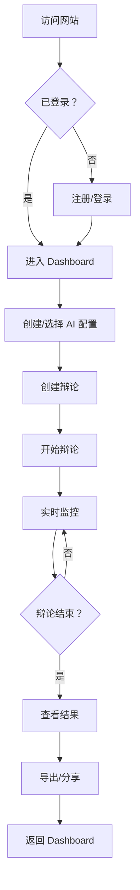

---

## 2. 认证流程

### 2.1 注册流程

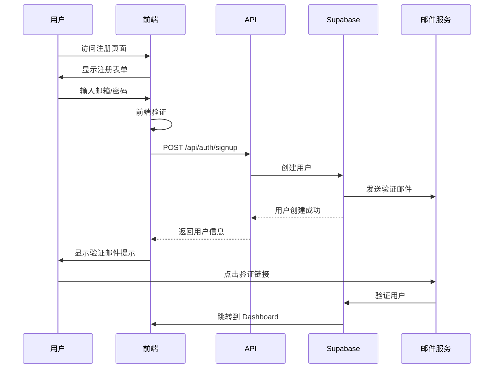

### 2.2 登录流程

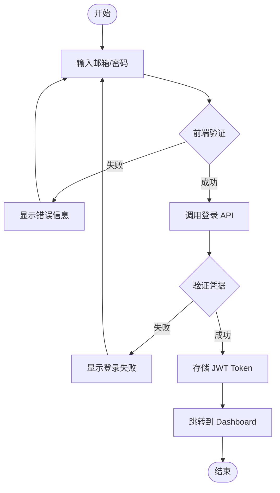

---

## 3. AI 配置管理流程

### 3.1 创建 AI 配置

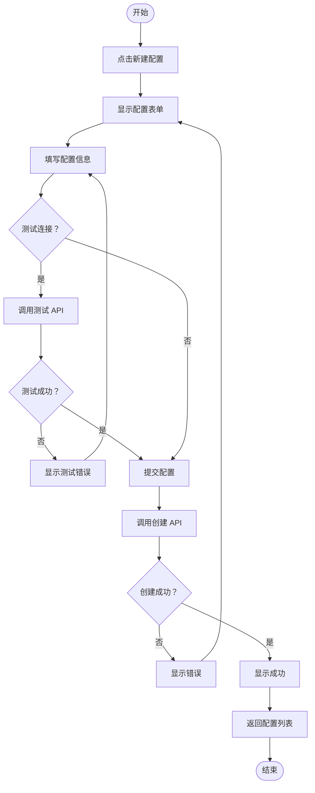

### 3.2 AI 配置管理

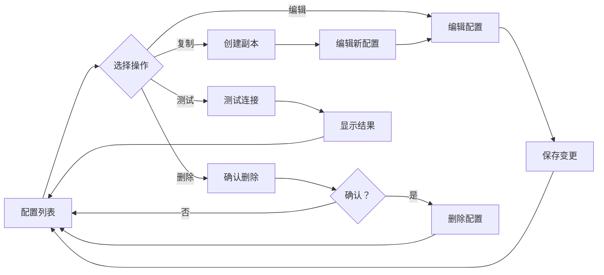

---

## 4. 辩论创建与运行流程

### 4.1 创建辩论

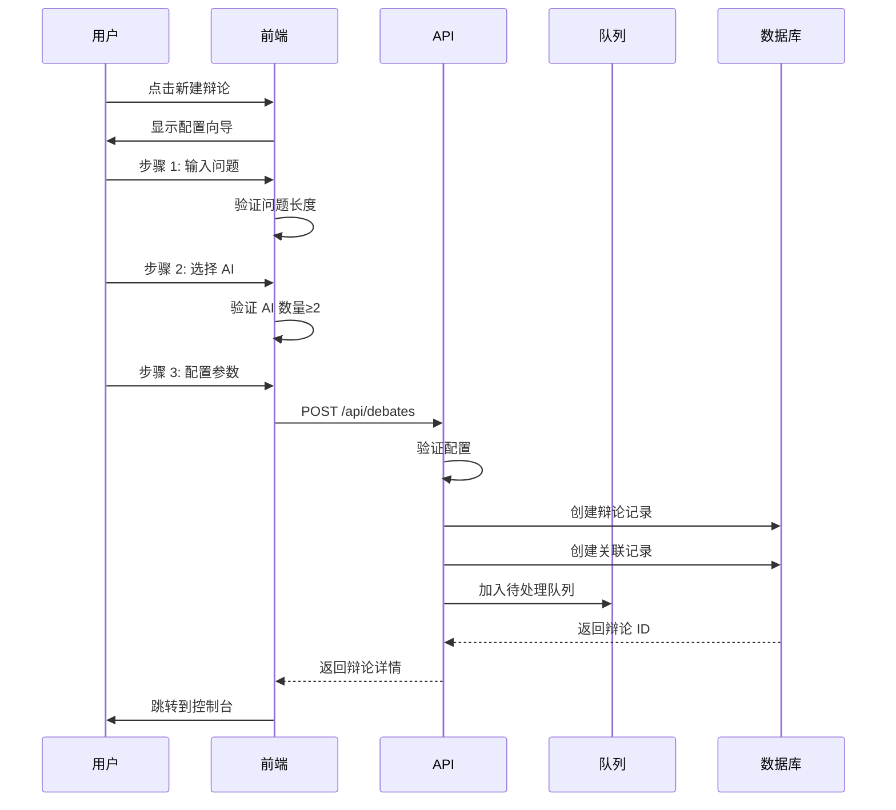

### 4.2 辩论运行流程

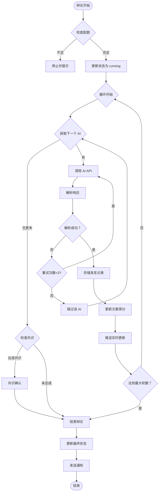

---

## 5. 实时监控流程

### 5.1 前端实时订阅

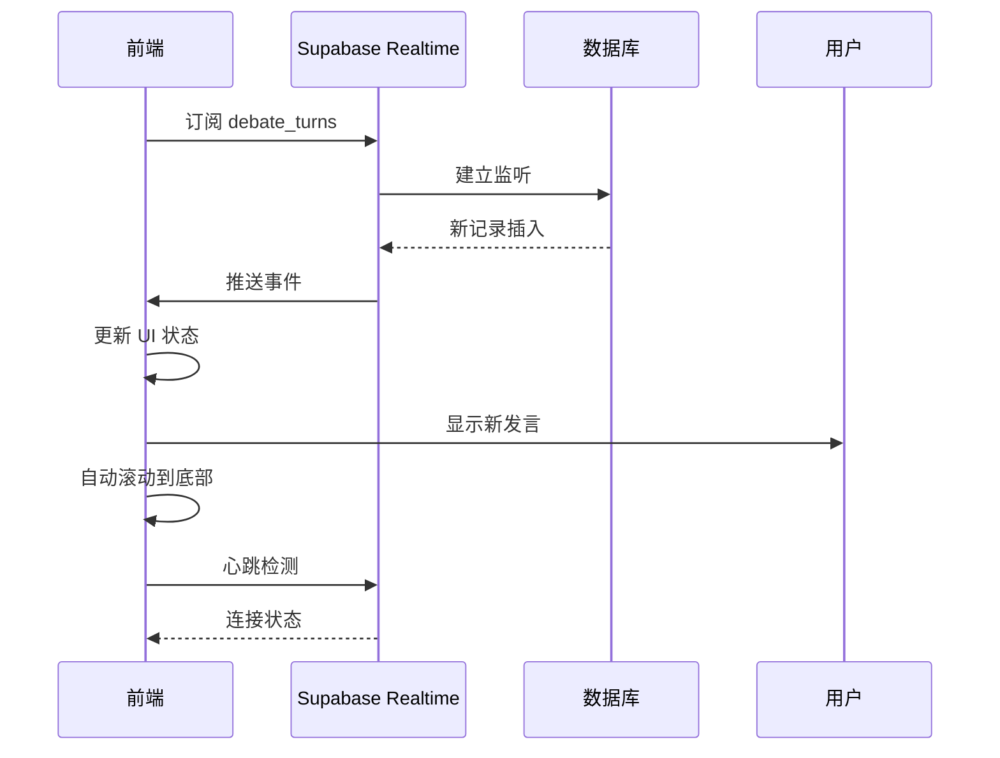

### 5.2 用户控制流程

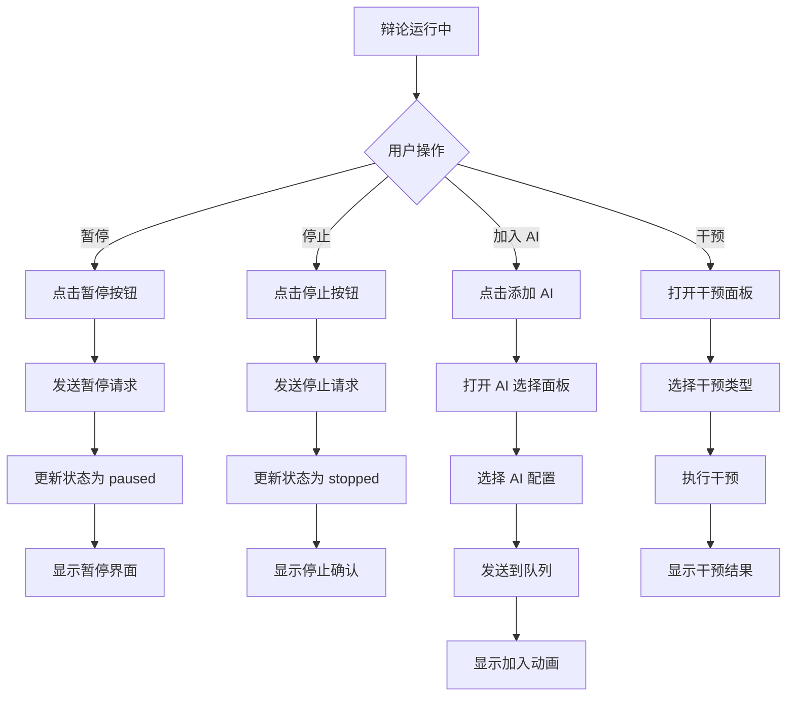

---

## 6. 结果展示流程

### 6.1 辩论完成处理

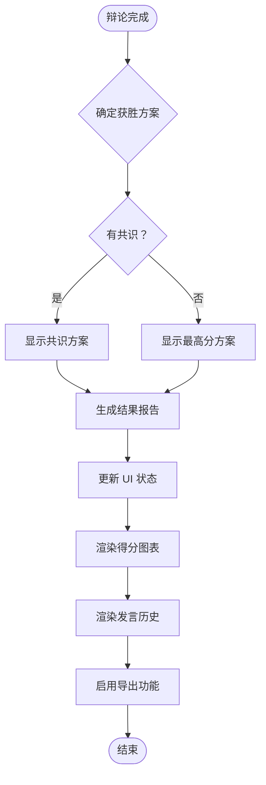

### 6.2 导出流程

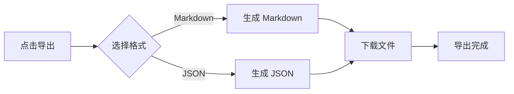

---

## 7. 异常处理流程

### 7.1 错误处理流程

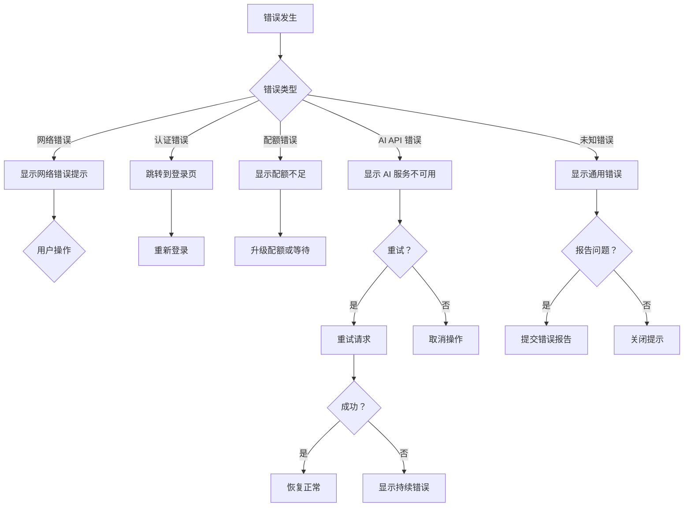

### 7.2 断线重连流程

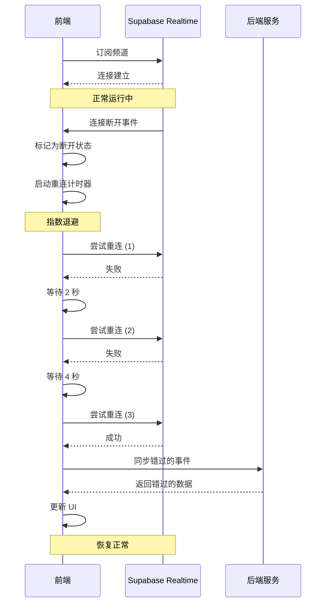

---

## 8. 配额管理流程

### 8.1 配额检查流程

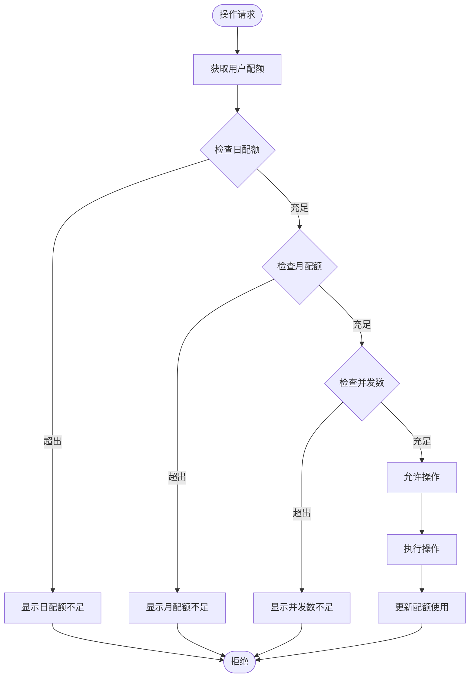

---

## 9. 状态机图

### 9.1 辩论状态机

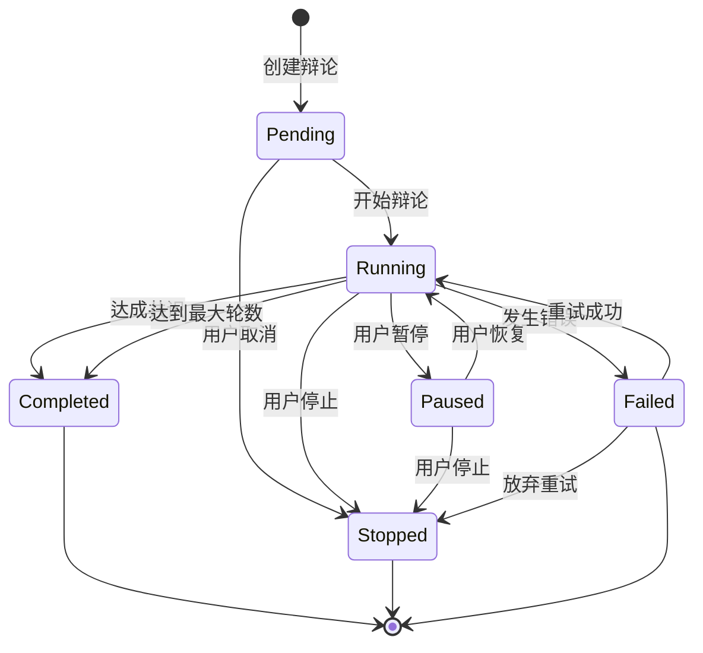

### 9.2 用户会话状态机

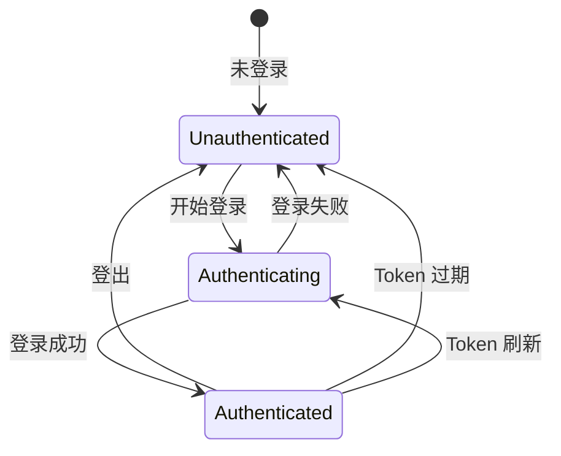

---

## 10. 数据流图

### 10.1 核心数据流

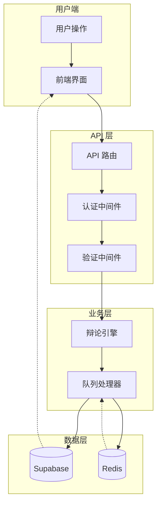

---

## 版本历史

| 版本 | 日期 | 变更 |
|------|------|------|
| 1.0 | 2026-03-06 | 初始用户流程图 |
